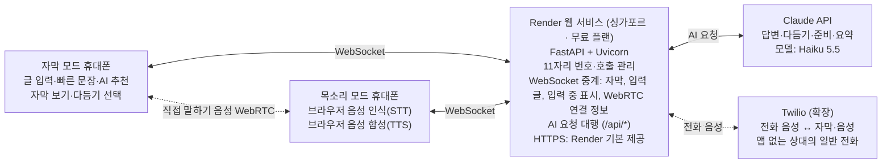
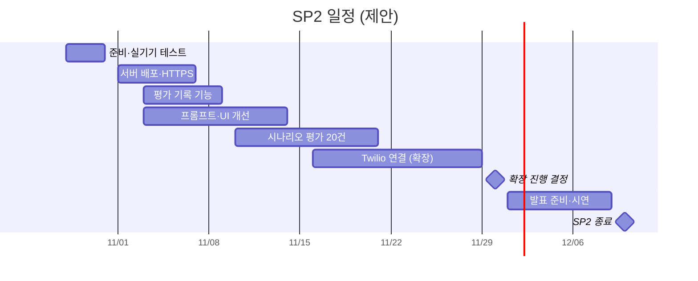

# 글소리 MVP 구현 계획 (SP2)

Oct 28, 2026 · @태발

## 1. 개요

SP2의 MVP는 청각장애인이 중계사 없이 앱 간 통화를 하고, AI 보조를 받으며, 고정 HTTPS 주소로 누구나 접속할 수 있는 상태를 말한다. SP2 기간은 2026년 11월 1일부터 12월 10일까지로 잡는다.

- **현재 상태:** 기획서 5장의 주요 기능 12개는 1차 구현을 마쳤다. 앱 간 통화 흐름과 AI 기능 4가지는 동작을 확인했고, 휴대폰 실기기 음성 기능은 검증이 남아 있다.
- **SP2 필수 목표:** 실기기 검증과 품질 개선, Render 배포(고정 HTTPS 주소 https://geulsori.onrender.com), 시나리오 통화 20건 평가
- **SP2 확장 목표:** Twilio를 이용한 실제 전화망 연결(앱이 없는 상대와 통화). 필수 목표를 마친 뒤 진행하며, 일정이 부족하면 SP3로 넘긴다.

## 2. 구현 기능 목록

SP2에서 다루는 기능은 18개다. 필수 14개는 1차 구현을 마쳐 검증과 개선이 남았고, 신규 2개는 SP2에서 새로 만들며, 확장 2개는 여유가 있을 때 진행한다. 담당은 기획서 8장의 역할 분담(이주표: 프론트엔드·UX·배포, 권태현: 서버·실시간 통신·AI)을 따랐다.

| # | 구분 | 기능 | 설명 | 상태 | 담당 |
| --- | --- | --- | --- | --- | --- |
| 1 | 필수 | 번호 배정·통화 연결 | 접속 시 11자리 번호 배정. 걸기·받기·거절·끊기, 상대 접속 종료 시 자동 종료 | 구현 완료 | 권태현 |
| 2 | 필수 | 통화 방식 선택 | 처음 접속 시 이름과 모드(자막/목소리) 선택. 모드에 따라 통화 화면이 달라짐 | 구현 완료 | 이주표 |
| 3 | 필수 | 실시간 자막(STT) | 목소리 모드 사용자의 말을 브라우저 음성 인식(Web Speech API)으로 받아적어 전송. 중간 결과는 점선 말풍선, 확정 후 자막 | 실기기 검증 필요 | 이주표 |
| 4 | 필수 | 입력 글 음성 변환(TTS) | 자막 모드 사용자가 보낸 글을 상대 기기가 한국어 음성으로 재생. 재생 중에는 음성 인식을 멈춰 에코 방지 | 실기기 검증 필요 | 이주표 |
| 5 | 필수 | 직접 말하기 | 말하기는 편한 사용자가 자막 모드에서도 자기 목소리를 WebRTC로 상대에게 전달 | 실기기 검증 필요 | 권태현 |
| 6 | 필수 | 입력 중 표시·대기 안내 | 입력 중이면 상대 화면에 표시. 4초를 넘기면 "잠시만요, 입력하고 있어요"를 음성으로 안내 | 실기기 검증 필요 | 이주표 |
| 7 | 필수 | 연결 안내 | 목소리 모드 사용자에게 "상대방은 자막으로 통화하고 있어요. 천천히 말씀해 주세요"를 자동 재생 | 실기기 검증 필요 | 이주표 |
| 8 | 필수 | 빠른 문장 | 기본·약속·마무리·준비 탭으로 묶은 문장을 한 번에 전송. 빈칸이 있는 문장은 입력창으로 옮겨 채운 뒤 전송 | 구현 완료 | 이주표 |
| 9 | 필수 | 중요 정보 강조·가독성 | 자막의 시간·날짜·인원·금액·전화번호를 노란색으로 강조(규칙 기반), 글자 크기 조절 | 구현 완료 | 이주표 |
| 10 | 필수 | 통화 기록 | 통화가 끝나면 대화 기록을 보여 주고 복사 가능 | 구현 완료 | 이주표 |
| 11 | 필수 | 통화 준비 도우미 | 통화 목적을 입력하면 AI가 첨인사와 예상 질문 6~8개별 답변을 만들어 '준비' 탭에 넣음 | 구현 완료 | 권태현 |
| 12 | 필수 | AI 답변 추천 | 상대 말이 끝날 때마다 방향이 다른 답변 3개를 버튼으로 제안. 간혹 상대 입장 문장이 섞여 프롬프트 개선 필요 | 개선 필요 | 권태현 |
| 13 | 필수 | 짧은 말 다듬기 | "내일 7시 2명 가능?" 같은 입력을 자연스러운 존댓말로 제안하고, 다듬은 문장과 원래 문장 중 사용자가 고른 것만 전송. 일부 어색한 존댓말 개선 필요 | 개선 필요 | 권태현 |
| 14 | 필수 | AI 통화 요약 | 통화 후 확정된 핵심 정보를 3~5줄로 요약하고 통화 목적 달성 여부를 판단. 인식 오류 의심 부분은 '(불확실)' 표시 | 구현 완료 | 권태현 |
| 15 | 신규 | Render 배포·HTTPS | 서버를 Render에 올려 HTTPS 고정 주소(https://geulsori.onrender.com) 제공. GitHub main에 push하면 자동 배포. 휴대폰 마이크 사용의 전제 조건 | 구현 완료 | 이주표 |
| 16 | 신규 | 평가 기록 | 추천 답변 채택 여부와 다듬기 선택 결과를 기록해 시나리오 평가의 채택률을 산출 | SP2 구현 예정 | 권태현 |
| 17 | 확장 | 실제 전화망 연결 | Twilio로 앱이 없는 상대에게 전화를 걸고 받음. 통화 음성을 서버에서 자막으로 바꾸고 입력 글을 음성으로 전달 | 확장 목표 | 권태현 |
| 18 | 확장 | 계정·친구 목록 저장 | 서버 메모리 대신 SQLite에 사용자 계정, 친구 목록, 고정 번호 저장 | 확장 목표 | 권태현 |

## 3. 시스템 구성

기획서 6장의 구조는 그대로 두고, 배포 환경과 외부 서비스만 바꾼다. 음성 인식과 합성은 휴대폰 브라우저가 처리해 서버 부담이 작다.

*문자는 서버를 거치고, 음성 인식·합성은 각 휴대폰이 처리한다. 점선은 기기 간 직접 연결(WebRTC)과 확장 목표(Twilio).*

서버는 통화 내용을 저장하지 않고 중계만 하며, 직접 말하기 음성은 서버를 거치지 않는다.

**기획서 대비 변경점**

| 항목 | 기획서 | SP2 변경 | 이유 |
| --- | --- | --- | --- |
| 배포 | 1차 ngrok, 2차 Render 등 클라우드 | Render 무료 웹 서비스(싱가포르), HTTPS 기본 제공, GitHub main 자동 배포(`render.yaml`) | AWS 지원이 어려워졌고, KT Cloud는 후불 결제라 사용 불가. Render는 비용 없이 HTTPS를 바로 제공 |
| 실제 전화의 음성 인식·합성 | Google Cloud Speech-to-Text(초기 설계) | Twilio 자체 기능 우선, 한국어 품질이 부족하면 네이버 CLOVA | 계정 수를 줄이고 한국어 품질을 확보 |
| AI 호출 | httpx로 Claude API 호출 | Anthropic 공식 Python SDK, 모델 claude-haiku-5-5 | 응답 형식(JSON) 검증을 SDK가 처리 |
| 개발 중 테스트 주소 | ngrok | Cloudflare Tunnel | 가입 없이 바로 HTTPS 주소 생성 |

## 4. SP2 일정

서버는 Render에 배포해 두고, 평가는 11월 10일부터 두 주 동안 진행하며, 12월 10일에 SP2를 마친다.

| 항목 | 기간 (2026년) |
| --- | --- |
| 준비·실기기 테스트 | 10/28 ~ 10/31 |
| 서버 배포·HTTPS | 11/1 ~ 11/7 |
| 평가 기록 기능 | 11/3 ~ 11/9 |
| 프롬프트·UI 개선 | 11/3 ~ 11/14 |
| 시나리오 평가 20건 | 11/10 ~ 11/21 |
| Twilio 연결 (확장) | 11/16 ~ 11/29 |
| 확장 진행 결정 | 11/30 |
| 발표 준비·시연 | 12/1 ~ 12/9 |
| **SP2 종료** | **12/10** |

날짜는 제안안이며 담당은 2장 표를 따른다. Twilio 연결은 11월 30일에 진행 상황을 보고 계속할지 SP3로 넘길지 정한다.

## 5. 리스크 관리 계획

가장 큰 리스크는 휴대폰 마이크 차단(HTTPS 미적용)과 음성 인식 오류로, 둘 다 친구와의 테스트에서 이미 나타났다. 영향과 가능성은 상·중·하 3단계로 판단하고, 매주 팀 회의에서 상태를 다시 확인한다.

| # | 리스크 | 영향 | 가능성 | 예방 대책 | 발생 시 대응 | 담당 |
| --- | --- | --- | --- | --- | --- | --- |
| R1 | HTTP 주소로 접속하면 휴대폰 마이크가 차단됨 (발생함) | 상 | 상 | Render의 HTTPS 주소로 배포(적용됨) | Cloudflare Tunnel 임시 HTTPS 주소 사용 | 이주표 |
| R2 | 음성 인식 오류·지연으로 잘못된 정보 전달 | 상 | 중 | 중요 정보 강조, "다시 말씀해 주세요" 빠른 문장, 요약의 '(불확실)' 표시 | 통화 기록으로 확인, 평가에 오류 사례 기록 | 이주표 |
| R3 | 아이폰 사파리·삼성 인터넷에서 음성 인식 미지원 | 중 | 상 | 안드로이드 크롬을 지원 환경으로 명시, 미지원 안내 문구(구현됨) | 해당 사용자는 자막 모드(입력)로 사용 | 이주표 |
| R4 | 읽어 주는 소리가 다시 자막에 잡힘(에코) | 중 | 중 | 재생 중 음성 인식 일시 정지(구현됨), 이어폰 사용 권장 | 같은 장소 테스트 시 기기 간 거리 두기 | 이주표 |
| R5 | AI가 상대 입장 문장을 추천하거나 뜻을 바꿈 (발생함) | 중 | 중 | 프롬프트 개선, 다듬은 문장은 사용자가 고른 것만 전송(구현됨) | 다듬기 끄기 선택 가능(구현됨), 오류 사례로 프롬프트 수정 | 권태현 |
| R6 | AI API 장애·응답 지연 | 중 | 하 | 경량 모델 사용, 최근 대화만 전송 | AI 실패 시 통화는 그대로 유지하고 AI 기능만 숨김(구현됨) | 권태현 |
| R7 | API 키 유출(깃허브 업로드 등) | 상 | 하 | 키는 서버 .env에만 보관, .gitignore로 제외(적용됨) | 즉시 키 비활성화 후 재발급 | 권태현 |
| R8 | Render 무료 서버가 15분간 접속이 없으면 잠들어 첫 접속에 약 1분 걸림, 장애 | 중 | 상 | 시연·평가 직전에 주소를 미리 열어 깨워 둠, 설정은 `render.yaml`로 보관 | 노트북 서버 + Cloudflare Tunnel로 임시 운영, 필요하면 유료 플랜(월 $7)으로 일시 전환 | 이주표 |
| R9 | 후불 청구로 인한 예산 초과 | 중 | 중 | 서버는 Render 무료 플랜 사용, Twilio 사용량 알림·자동 충전 끄기 | 불필요한 자원 즉시 삭제 | 이주표 |
| R10 | Twilio 제약(미국 번호·국제 전화 표시, 스팸 차단, 국내 번호 불가) | 중 | 상 | 확장 목표로 분리, 국가 허용을 대한민국으로 제한, 사전에 알린 지인에게만 발신 | 앱 간 통화로 시연하고 전화망 연결은 SP3로 이월 | 권태현 |
| R11 | 2인 팀 일정 지연 | 상 | 중 | 필수 기능 우선, 확장 목표는 11월 30일에 중단 여부 결정 | 확장 목표를 SP3로 넘기고 평가·발표 준비에 집중 | 이주표·권태현 |
| R12 | 통화 내용(개인정보)이 서버와 AI로 전송됨 | 중 | 하 | 서버는 통화 내용을 저장하지 않고 중계만 함, AI에는 최근 대화만 전송 | 평가 참여자에게 사전 안내·동의 | 권태현 |
| R13 | 실제 업체 시험 통화로 인한 업무 방해 | 하 | 중 | 시험은 팀원·지인 대상, 업체 시연은 사전 동의한 곳 1~2번만 | 즉시 중단하고 사과 | 이주표 |

## 6. 완료 기준과 평가 방법

SP2는 아래 필수 항목을 모두 만족하면 완료로 본다. 확장 목표(Twilio)는 완료 기준에 넣지 않는다.

- [ ] 안드로이드 휴대폰 2대에서 필수 기능 1~14번이 모두 동작한다
- [ ] Render의 고정 HTTPS 주소(https://geulsori.onrender.com)에서 마이크가 정상적으로 켜지고 통화가 연결된다
- [ ] 청인의 말이 1~2초 안에 자막으로 표시된다(기획서 2장 목표, 평가 통화에서 실측)
- [ ] 예약·약속 시나리오 통화 20건을 진행하고 결과를 기록한다
- [ ] AI 답변 추천에서 상대 입장 문장이 나오는 문제를 고친다

**평가 방법** (기획서 7장 평가 계획)

| 지표 | 측정 방법 | 목표치 |
| --- | --- | --- |
| 추천 답변 채택률 | 추천이 나온 횟수 중 버튼을 눌러 보낸 비율(평가 기록 기능) | 팀 합의 필요 |
| 다듬기 선택률 | 다듬은 문장을 고른 비율, 뜻이 바뀐 사례 수 | 뜻 변경 0건 |
| 요약 정확도 | 통화당 핵심 정보(날짜·시간·장소·인원) 누락 수와 오류 수 | 팀 합의 필요 |
| 자막 지연 | 말이 끝난 뒤 확정 자막이 뜨기까지 걸린 시간 | 2초 이내 |
| 목적 달성률 | AI 판단과 실제 결과(팀원 판단)가 일치한 비율 | 팀 합의 필요 |

열린 질문: 채택률·요약 정확도·목적 달성률의 목표치를 평가 시작 전(11월 10일)까지 팀이 정한다.
